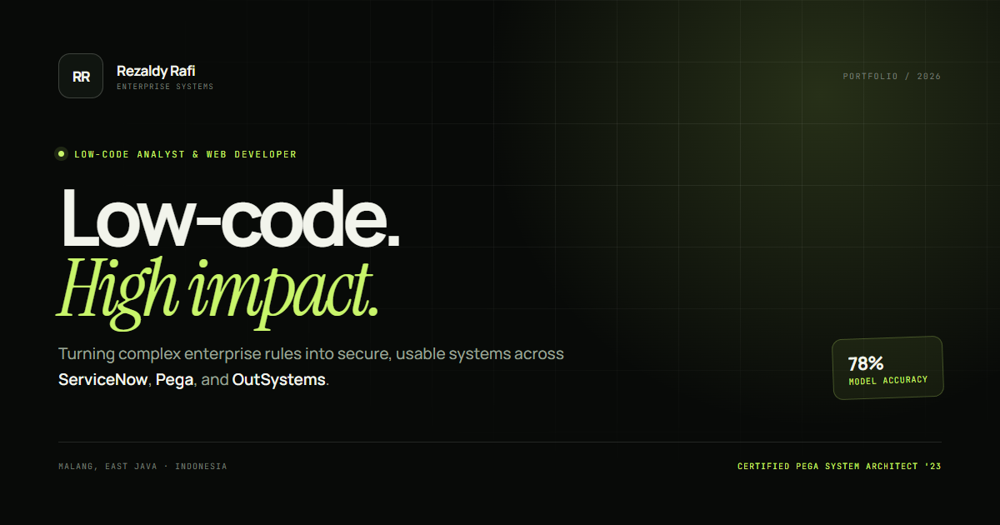

# Rezaldy Rafi — Portfolio

A personal portfolio for a low-code analyst and full-stack developer working across **ServiceNow, Pegasystems, OutSystems, Laravel, and Python**.

The site is built as a fast, single-page React application with an editorial visual system, light/dark themes, project case studies, and a working contact form.



## What is in the site

- **Hero** — positioning, current role, platform focus, and headline metrics.
- **About** — delivery philosophy, capabilities, and a four-step working process.
<<<<<<< HEAD
- **Selected work** — four project case studies with custom product visuals:
  - Enterprise Whistle Blowing System
  - News Article Topic Classification
  - East Java Tourism Information System
  - Cashbook Nusantara
=======
- **Selected work** — three project case studies with custom product visuals:
  - Enterprise Whistle Blowing System
  - News Article Topic Classification
  - East Java Tourism Information System
>>>>>>> a3077494101343ee9a3003c2226e8331ede2ab77
- **Case-study modals** — overview, build details, outcomes, stack, and evidence gallery with keyboard-accessible lightbox.
- **Experience** — Accenture role grouped into ServiceNow, Pega, and OutSystems tracks, plus earlier experience.
- **Toolkit** — enterprise platforms, web engineering, data/integration, and delivery/quality.
- **Credentials** — education and four certifications, including Pega System Architect '23.
- **Contact** — copy-to-clipboard details and a Web3Forms-powered message form.

## Stack

- React 18 + TypeScript
- Vite 8
- Lucide icons
- Hand-written CSS with design tokens (no component library)
- Google Fonts: Manrope, Instrument Serif, JetBrains Mono
- Web3Forms for the contact form

## Run locally

Requires Node.js 20.19+ (or 22.12+).

```bash
npm install
npm run dev
```

Open the URL printed by Vite, usually `http://localhost:5173`.

## Build

```bash
npm run build
npm run preview
```

`npm run build` runs the TypeScript compiler before creating the production bundle in `dist/`.

## Project structure

```text
.
├── public/
│   ├── favicon.svg
│   ├── og.png
│   └── projects/            # project evidence screenshots
├── src/
│   ├── components/
│   │   ├── ContactForm.tsx
│   │   ├── ProjectModal.tsx
│   │   └── ProjectVisual.tsx
│   ├── App.tsx              # page composition and interactions
│   ├── data.ts              # résumé, projects, skills, certifications
│   ├── main.tsx
│   └── styles.css           # tokens, layout, components, responsive rules
├── index.html
├── package.json
├── tsconfig.json
└── vite.config.ts
```

## Editing content

Most content lives in [`src/data.ts`](src/data.ts). Update the `profile`, `projects`, `experience`, `skillGroups`, and `certifications` objects there. The layout reads from those objects, so new projects or roles appear without touching the page structure.

Project screenshots live in `public/projects/` and are referenced from the `images` array of a project.

## Themes and motion

- Defaults to the visitor's system color scheme.
- Manual theme choice is stored in `localStorage` under `rr-theme`.
- Scroll reveals and the marquee respect `prefers-reduced-motion`.
- The layout is tested from 390 px through 1440 px.

## Contact form

The form posts to Web3Forms. The access key is in `src/components/ContactForm.tsx`. Replace it with your own key if you fork the project:

```ts
access_key: "YOUR_WEB3FORMS_ACCESS_KEY";
```

Web3Forms access keys are intended to be used in client-side forms. If the request fails, the visitor is given a direct email fallback.

## Deployment

The site is a static Vite build, so it deploys to Vercel, Netlify, Cloudflare Pages, or any static host.

- Build command: `npm run build`
- Output directory: `dist`

For a GitHub Pages project site served from a subpath, set `base` in `vite.config.ts` (for example `base: "/Porto/"`) and make asset paths base-aware.
